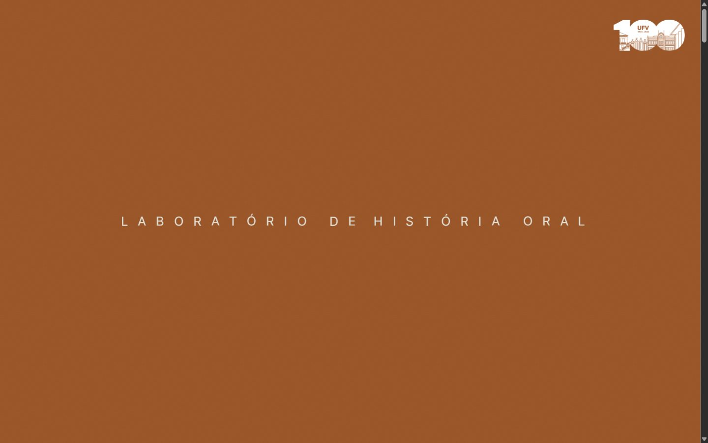

# LabHO — Laboratório de História Oral

Site oficial e editável do Laboratório de História Oral do Departamento de História da Universidade Federal de Viçosa (DHI/UFV): um acervo público de entrevistas com pessoas negras e indígenas da Zona da Mata mineira e com quem construiu a universidade.

Construído com **Next.js 15 (App Router)**, **TypeScript**, **Tailwind CSS**, **Three.js** e gerenciamento de conteúdo completo via **Sanity Studio**.



---

## 🎯 Arquitetura & Edição com Sanity

O projeto foi migrado de WordPress para **Sanity CMS**, permitindo que 100% do conteúdo seja editado pela equipe do laboratório em tempo real pelo **Sanity Studio** integrado em `/studio`.

O site funciona com um adaptador duplo (`lib/cms/`):
- **Sem Sanity configurado:** o site roda automaticamente com 100% das páginas, entrevistas, eventos, fotos e dados de demonstração locais (`fixtureSource`), sem quebrar nem exigir credenciais.
- **Com Sanity configurado:** basta preencher `NEXT_PUBLIC_SANITY_PROJECT_ID` em `.env.local` e o site passa a consumir os dados do Sanity (`sanitySource`), com suporte a rascunhos em tempo real pelo modo de pré-visualização (Draft Mode).

### Painel Sanity Studio (`/studio`)

O painel foi estruturado em português (`@sanity/locale-pt-br`) e organizado de forma intuitiva:

| Seção | Tipo | Descrição |
|---|---|---|
| 🏠 **Página Inicial** | `homePage` | Linhas do wordmark, manchete de abertura, texto de apresentação, foto e carrossel de fotos |
| ℹ️ **Sobre o laboratório** | `sobrePage` | Texto de apresentação da equipe e método, galeria e texto de produções |
| ✉️ **Página de Contato** | `contatoPage` | Título, introdução e textos adicionais |
| ⚙️ **Configurações & Contatos** | `siteSettings` | E-mail, endereço institucional, Instagram, YouTube, citação do rodapé e logos de apoio |
| 🗂️ **Projetos do Acervo** | `projeto` | Nome, slug, apresentação completa, capa, galeria e ordem |
| 🎙️ **Entrevistas** | `entrevista` | Nome, projeto vinculado, ocupação/resumo, fala em destaque (3D), foto, link do YouTube, PDF da transcrição, ficha técnica estruturada e galeria |
| 📅 **Agenda de Eventos** | `evento` | Nome, data, local, descrição, foto, gravação de vídeo e certificados |
| 🎬 **Produções** | `producao` | Nome, tipo (YouTube, Artigo, Drive, Livro), resumo, link e ordem |

---

## 🚀 Como Executar

### 1. Pré-requisitos
- Node.js 20+ instalado.

### 2. Instalação e Desenvolvimento
```bash
# Instalar dependências
npm install

# Rodar servidor local
npm run dev
```

Acesse:
- **Site:** [http://localhost:3000](http://localhost:3000)
- **Painel Sanity Studio:** [http://localhost:3000/studio](http://localhost:3000/studio)

### 3. Conectando ao Sanity & Importação Inicial (1 clique)

1. Crie um projeto gratuito em [sanity.io/manage](https://sanity.io/manage).
2. Copie seu **Project ID** e crie um token com permissão **Editor** (em *API → Tokens*).
3. No arquivo `.env.local`:
   ```bash
   NEXT_PUBLIC_SANITY_PROJECT_ID=seu_project_id
   NEXT_PUBLIC_SANITY_DATASET=production
   SANITY_API_WRITE_TOKEN=seu_token_aqui
   ```
4. Em *API → CORS origins* no Sanity, libere `http://localhost:3000` (e o domínio de produção).
5. Popule o Sanity com todos os dados iniciais do acervo rodando:
   ```bash
   npm run seed
   ```
6. Pronto! O site agora está 100% conectado e editável via `/studio`.

---

## 🎨 Recursos Visuais & Interativos

- **Abertura & Wordmark Animado:** Na home, as palavras entram letra por letra e, ao rolar a página, o wordmark viaja suavemente do centro do hero para o cabeçalho fixo.
- **Cena 3D "Vozes do acervo":** Desenvolvida em Three.js com personagens low-poly, câmera guiada pelo scroll e balões interativos projetados a partir das cabeças 3D, conectados às falas e entrevistas cadastradas no CMS.
- **Busca e Filtro A–Z:** Na página de cada projeto (`/acervo/[slug]`), busca instantânea por nome e filtragem por letras iniciais do alfabeto.
- **Pop-up de Vídeo (YouTube):** Modal nativo para assistir às entrevistas e gravações de eventos sem sair da página.
- **Cursor Personalizado & Hover Preview:** Em telas com mouse, o cursor flutua suavemente e expande ao passar sobre elementos clicáveis; na lista de eventos, exibe preview flutuante da imagem.
- **Rolagem Suave:** Integrada com Lenis e revelações por `IntersectionObserver` (`.rv`, `.split`).
